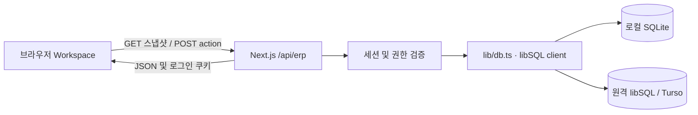

# 서비스 구조와 데이터 흐름

근거: [workspace.tsx](../app/workspace.tsx), [route.ts](../app/api/erp/route.ts), [db.ts](../lib/db.ts), [next.config.ts](../next.config.ts).

## 구성도

DB는 두 곳을 동시에 사용하는 구조가 아니다. `ERP_DATABASE_URL` 유무에 따라 한 연결을 선택한다. API는 별도 백엔드 서버가 아닌 Next.js Route Handler다.

## 파일과 실행 환경

| 파일 | 책임 |
| --- | --- |
| `app/layout.tsx` | 한국어 문서 언어, HAMS WORKS 메타데이터, 전역 CSS |
| `app/page.tsx` | 클라이언트 컴포넌트 `Workspace` 렌더링 |
| `app/workspace.tsx` | 로그인, 공통 레이아웃·모달, 탭·공통 상태, API 요청·폴링·heartbeat |
| `components/workspace/*-module.tsx` | 대시보드·구성원·출퇴근·원격근무·급여·정산의 메뉴별 화면과 조회·집계·CSV |
| `components/workspace/attendance-control.tsx` | 대시보드와 출퇴근 화면의 근무 현황·출퇴근 버튼 |
| `components/workspace/people-table.tsx`, `remote-cards.tsx` | 대시보드와 개별 메뉴에서 재사용하는 구성원 표·원격 상태 카드 |
| `components/workspace/avatar.tsx`, `utils/index.ts`, `types/index.ts` | 공통 아바타, 날짜·시간·금액·원격 상태 함수, 변경 요청 콜백 타입 |
| `lib/use-remote-presence.ts` | Idle Detection 권한·감지 수명 관리, heartbeat 전송, 미지원·거절 처리 |
| `lib/remote-settings.ts` | 공통 자리비움 시간의 기본값·입력 범위·검증 |
| `app/register/page.tsx` | 비로그인 회원등록 페이지 |
| `app/password-change.tsx` | 최초 필수 변경·일반 비밀번호 변경 모달, 확인·현재 비밀번호 입력 |
| `components/workspace/account-menu.tsx` | 헤더 사용자 메뉴, 본인 회원정보 변경 모달, 일반 비밀번호 변경 진입 |
| `lib/password.ts` | 초기 비밀번호, 개인별 scrypt 해시 생성·검증 |
| `app/api/erp/route.ts` | GET 조회, POST action 변경, 인증·검증·오류 처리 |
| `lib/db.ts` | DB client 생성, 테이블·시드 초기화, 한국 날짜 산출 |
| `lib/types.ts` | Employee, Attendance, Remote, Payroll, Snapshot 타입 |
| `app/globals.css` | 반응형 화면, 사이드바·표·모달·로그인 스타일 |
| `app/auth.module.css` | 회원가입 버튼·회원등록 카드·최초 비밀번호 변경 모달의 컴포넌트 전용 스타일 |

파일시스템·Node crypto·libSQL client를 사용하므로 서버 기능은 Node.js 환경을 전제로 한다. `next.config.ts`에는 Cache Components, Partial Prefetching, agentFeedback, Tailwind CSS용 Turbopack 규칙이 켜져 있다. DB 조회 결과를 공유 캐시에 저장하는 `use cache` 코드는 없다.

Tailwind용 Turbopack loader는 `globals.css`에만 적용한다. `.module.css`까지 `as: "*.css"`로 변환하면 CSS Module의 클래스 매핑이 사라질 수 있으므로 일반적인 `*.css` 전체 규칙으로 넓히지 않는다. 인증 컴포넌트는 CSS Module을 직접 import해 생성된 클래스명을 JSX에 연결한다.

## 화면 진입과 변경 처리

1. 초기 화면은 로딩 UI다. 클라이언트 clock은 고정된 초기 날짜로 생성하고 effect에서 실제 시각으로 바꾸어 prerender 시각 의존성을 피한다.
2. effect에서 현재 시각·월을 설정하고 `refresh()`로 GET `/api/erp`를 호출한다.
3. GET이 401이면 `data=null`로 두고 로그인 화면을 표시한다. 다른 오류는 알림으로 보여 준다.
4. 성공하면 Snapshot을 React state에 저장한다. user.must_change_password=1이면 필수 변경 모달만 제공하고, 완료 후 업무 화면을 렌더링한다. API도 같은 조건으로 업무 데이터를 제한한다.
5. `act()`는 busy 설정 → POST 변경 → GET 전체 재조회 → 성공 알림 순서로 실행한다. 낙관적으로 DB 변경을 가정하지 않는다.
6. 로그인한 동안 15초 간격으로 전체 스냅샷을 갱신한다. 탭을 바꿔도 동일한 데이터가 쓰인다.

POST 자체는 성공했어도 이어지는 GET이 실패하면 `act()`가 오류로 표시할 수 있다. 성공 여부를 조사할 때 변경 요청과 후속 조회를 나누어 확인해야 한다. GET 401은 예외 대신 로그인 화면으로 전환하므로 일부 세션 만료 흐름에서는 알림과 화면 상태가 엇갈릴 수 있다.

5개 업무 화면은 URL별 페이지가 아니라 `tab` 숫자로 전환하는 동일 페이지다. 탭·필터·선택 월은 URL이나 DB에 보존하지 않아 새로고침하면 기본값으로 돌아간다. 상태 관리는 `useState`, `useRef`, `useEffect`이며 Zustand store는 없다.

## 주기와 시각의 역할

| 값 / 주기 | 용도 |
| --- | --- |
| 클라이언트 clock, 1초 | 현재 시각·날짜·원격 상태 계산 |
| GET, 15초 | 인사·근태·원격·정산 전체 조회 |
| heartbeat, 20초 및 기기 상태 변경 시 | 공유 중인 계정의 연결·기기 활동·화면 잠금 상태 갱신 |
| `serverTime` | GET 응답 시 서버 시각. 미퇴근 기록의 경과 시간 계산 기준 |
| `koreaDay()` | 서버에서 `Asia/Seoul` 근무일 산출 |

출퇴근 저장 시각·세션 만료·heartbeat는 서버 기준이다. UI의 원격 판정은 클라이언트 clock을 사용하므로 PC 시계가 틀리면 상태 오차가 생길 수 있다. 브라우저의 백그라운드 타이머 제한도 실제 갱신 주기에 영향을 준다.

## 조회 범위와 집계

API는 관리자에게 모든 구성원·원격·정산을 반환하고, member에게 본인 데이터만 반환한다. 클라이언트 집계는 그 응답 범위 안에서 수행한다.

| 지표 | 계산 |
| --- | --- |
| 전체 구성원 / 나의 프로필 | `employees.length` |
| 오늘 근무 중 | 근태 중 `day=오늘`이고 `check_out`이 없는 건수 |
| 사무실·원격 인원 | 오늘 근무 중인 기록의 `mode` 분류 |
| 원격 활동 중 | `remoteState()`가 활동 중인 최신 원격 행의 수 |
| 당월 정산 예정 | 클라이언트 오늘의 월과 같은 정산의 `base+adjustment-deduction` 합계 |

근태는 역할별 조회 후 최근 500건까지만 받는다. 관리자에게는 전 직원 합산 500건이다. 월별 표와 CSV는 이 배열을 다시 필터링한다. 원격 활동 인원은 출근 배열과 교차 검증하지 않는다. 대시보드 구성원 목록은 앞의 5명, 원격 미니 목록은 종료되지 않은 행 중 앞의 3명을 표시한다.

## 기술 의존성의 실제 사용

Next.js·React·TypeScript·Tailwind·lucide-react·libSQL이 현재 구현에 쓰인다. `@hams-fam/sso-client`, `@google/genai`, Zustand는 설치 목록에 있지만 ERP 코드에서 연결되어 있지 않다. 의존성 존재만으로 SSO·AI·외부 상태 관리 기능이 제공된다고 판단하지 않는다.
