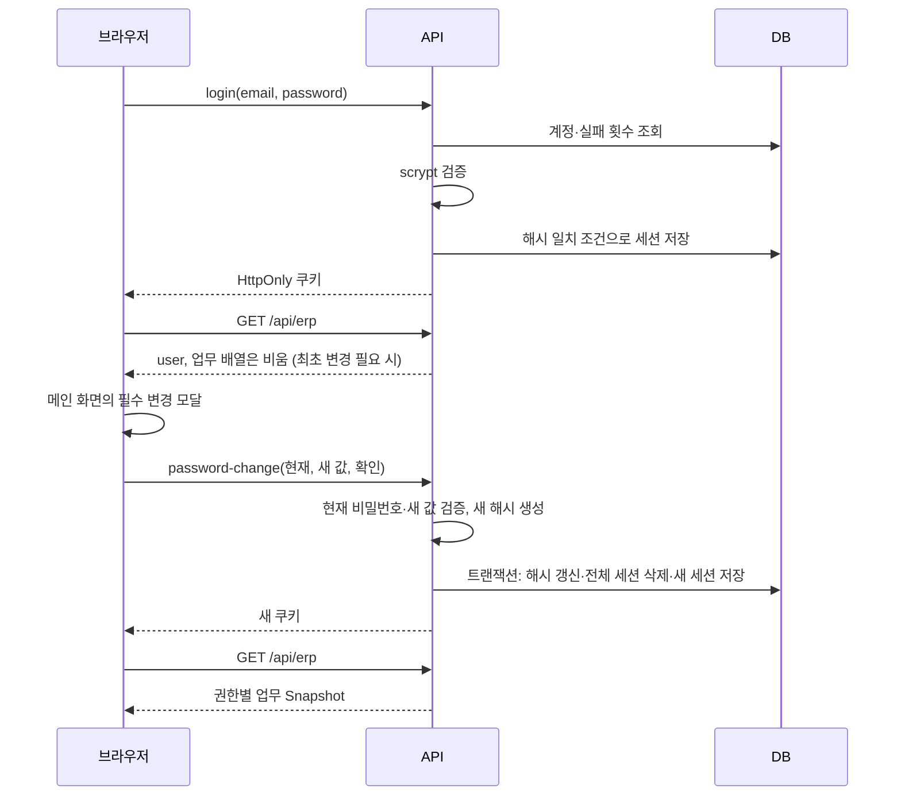

# 회원등록·계정별 비밀번호·세션

근거: [route.ts](../app/api/erp/route.ts), [password.ts](../lib/password.ts), [db.ts](../lib/db.ts), [비밀번호 변경 모달](../app/password-change.tsx), [회원등록 페이지](../app/register/page.tsx).

## 인증 모델과 회원등록

회원등록 폼에는 초기 비밀번호를 읽기 전용 입력란으로 표시한다. 회원등록과 최초·일반 비밀번호 변경의 입력란은 기본적으로 암호를 숨기고, 우측 눈 아이콘 버튼으로 각 입력란의 표시·숨김을 독립적으로 전환한다.

계정은 employees 행이며 password_hash에 계정별 비밀번호 해시를 저장한다. 허용 이메일 3개와 환경 변수 공통 비밀번호를 검사하던 이전 방식은 제거했다. `ERP_DEMO_PASSWORD`·`ERP_ENABLE_DEMO_LOGIN`은 더 이상 읽지 않는다.

로그인 화면의 회원등록 버튼은 `/register`로 이동한다. 이름·이메일·소속·직무·직원/프리랜서 유형을 제출하면 초기 비밀번호 `hams1234!`, 필수 변경 표시 1, member 권한, 월 금액 0원, 프로젝트 미배정, 오늘 입사일로 생성한다. 클라이언트가 전달한 role·salary·password는 등록에 사용하지 않는다. 중복 이메일은 409다. 관리자 구성원 등록도 초기 비밀번호가 있는 계정을 만든다.

회원등록은 비로그인 상태에서 가능하다. 이메일 소유 확인·가입 승인·초대 제한·가입 요청 속도 제한은 아직 없다. 기존 직원 이메일에 대한 중복 가입은 해당 계정을 연결하거나 비밀번호를 초기화하지 않고 거절한다.

## 비밀번호 저장

개인별 16바이트 무작위 salt와 Node.js 비동기 scrypt를 사용한다. 파라미터는 N=32768, r=8, p=3, 결과 64바이트이며 maxmem은 64MiB다. 저장 형식은 `scrypt$32768$8$3$<salt hex>$<hash hex>`다. 검증 시 형식·길이를 확인하고 같은 파라미터로 도출한 값을 timingSafeEqual로 비교한다.

이는 복호화용 암호화가 아닌 단방향 해시다. API는 명시한 인사 공개 필드만 반환하고 password_hash는 관리자에게도 전송하지 않는다. 미가입 이메일도 같은 비용의 더미 scrypt를 수행해 일반적인 계정 조회 시간 차이를 줄인다.

선택한 파라미터는 [OWASP Password Storage의 scrypt 구성](https://cheatsheetseries.owasp.org/cheatsheets/Password_Storage_Cheat_Sheet.html)을 참고한다. Node 동작은 [공식 crypto 문서](https://nodejs.org/api/crypto.html#cryptoscryptpassword-salt-keylen-options-callback)를 따른다.

## 기존 DB 전환

실제 API 요청에서 기존 employees 테이블에 인증 컬럼이 없으면 추가한다. 해시가 없는 계정에만 초기 비밀번호 해시를 생성하고 해당 계정의 기존 세션을 삭제한다. 이름·급여·근태·원격·정산은 덮어쓰지 않는다. 새 인스턴스에서도 NULL 조건을 재확인해 이미 설정·변경된 비밀번호를 유지한다.

전환 전의 환경 공통 비밀번호가 무엇이었든 해시가 없던 계정은 `hams1234!`로 로그인하고 최초 변경해야 한다. 기존 DB는 배포 전 백업한다. 빌드 시에는 GET이 먼저 요청 쿠키 경계에 도달하도록 하여 prerender에서 인증 마이그레이션을 실행하지 않게 한다.

## 로그인과 최초 변경

로그인 이메일은 trim·소문자 변환하고 lower(email)로 조회한다. 로그인 성공 시 이메일별 실패 제한 행을 삭제한다. 실패는 15분 기간 내 누적하며 10회 이상이면 이후 요청에 429를 반환한다. IP 기반 제한은 없다.

최초 변경 전 GET은 공개 user와 빈 employees·attendance·remote·payroll 배열만 반환한다. POST는 password-change·logout만 허용한다. UI 모달을 우회해 직접 API를 호출해도 업무 요청은 403이다. 모달은 Escape·배경 클릭으로 닫히지 않으며 폼 내 Tab 이동을 유지한다. 로그아웃은 가능하다.

새 비밀번호는 10~128자이고 초기 비밀번호·현재 비밀번호와 달라야 한다. 확인값이 같아야 하며 공백만으로 구성할 수 없다. 현재 비밀번호를 다시 검증한다. 최초 변경 이후에는 헤더의 사용자 이름 → 비밀번호변경 메뉴로 같은 모달을 열 수 있다. 일반 변경 모달은 취소·Escape·배경 클릭으로 닫을 수 있으며 저장 중에는 닫기를 막는다. 분실 재설정 기능은 없다.

헤더의 사용자 이름 → 회원정보변경 메뉴에서는 본인의 이름·소속·직무를 변경한다. 각 값은 trim 후 1~50자로 검증한다. 서버가 세션의 사용자 ID로 수정 대상을 결정하며 권한·급여·다른 계정은 변경하지 않는다. 저장 후 스냅샷을 다시 조회하여 헤더와 구성원 목록에 반영한다.

동시 변경에서는 기존 해시 일치 조건으로 UPDATE하여 먼저 변경된 값을 덮어쓰지 않는다. 변경·기존 전체 세션 삭제·새 세션 저장은 하나의 write 트랜잭션이다. 로그인도 검증한 해시가 아직 같은 경우에만 세션을 저장해 변경 직전 비밀번호로 늦게 세션이 발급되는 것을 막는다.

## 세션·권한·로그아웃

세션 원문은 32바이트 무작위 hex이며 SHA-256 해시만 sessions에 저장한다. hams_session 쿠키는 HttpOnly, SameSite=Lax, Path=/, 8시간 만료다. Secure는 VERCEL=1이거나 요청 URL이 HTTPS일 때 켠다. 세션 자동 연장·만료 행 정리는 없다.

| 작업 | admin | member |
| --- | --- | --- |
| 최초 비밀번호 변경 전 | 본인 변경·로그아웃만 | 본인 변경·로그아웃만 |
| 구성원·원격·정산 조회 | 전체 | 본인 |
| 근태 조회·CSV | 전체 최근 500건 | 본인 최근 500건 |
| 출퇴근·공유 | 본인 | 본인 |
| 이름·소속·직무, 비밀번호 변경 | 본인 | 본인 |
| 구성원·정산 수정 | 허용 | 403 |
| 공통 원격지원설정 변경 | 허용 | 403 |

프리랜서 유형과 관리자 역할은 별개다. role은 매번 DB에서 읽는다. POST의 Origin이 있으면 host가 요청 Host와 같은지 검사한다. Origin 없는 요청은 허용하고 별도 CSRF 토큰은 없다.

로그아웃은 현재 세션 삭제와 계정 원격 공유 종료를 batch로 수행하고 쿠키를 삭제한다. 다른 로그인 세션은 유지하지만 계정 단위 원격 행은 함께 종료된다. 출근을 퇴근 처리하지 않는다. 비밀번호 변경은 로그아웃과 달리 **그 계정의 모든 기존 세션**을 무효화한다.
