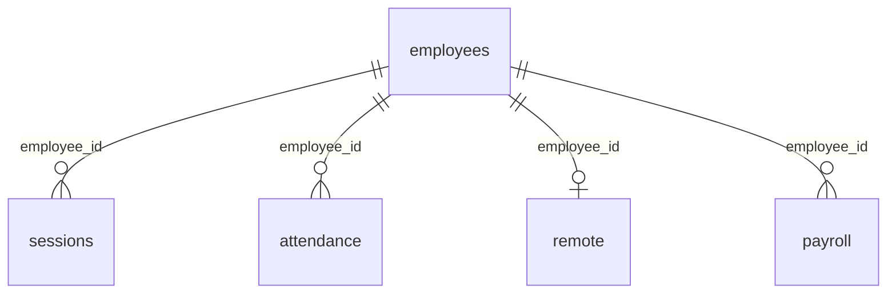

# 데이터베이스와 초기화

근거: [db.ts](../lib/db.ts), [route.ts](../app/api/erp/route.ts), [types.ts](../lib/types.ts).

## 연결 선택

모듈 로드 시 `ERP_DATABASE_URL`을 읽는다. 값이 없으면 작업 디렉터리에 `data`를 만들고 `file:data/erp.db`로 연결한다. 값이 있으면 해당 URL에 연결하고 `ERP_DATABASE_AUTH_TOKEN`을 인증에 사용한다. 코드가 이 값을 trim하지 않으므로 공백·따옴표가 값에 섞이지 않게 설정한다.

DB 연결 생성과 로컬 디렉터리 생성은 API 함수의 try/catch 밖에서 발생한다. 여기서 실패하면 API의 표준 JSON 오류가 아닌 플랫폼 오류 응답이 나올 수 있다. `ERP_DATABASE_URL=file:...`를 직접 지정한 경우에는 코드가 해당 상위 디렉터리를 자동 생성하지 않는다.

## 초기화 생명주기

`initialize()`는 `setup()`의 Promise를 모듈 변수 `ready`에 보관한다. 같은 서버 모듈 인스턴스의 동시 요청은 초기화 Promise를 공유하며, 실패하면 값을 비워 다음 요청에서 다시 시도한다. 서버 재시작·서버리스 새 인스턴스에서는 초기화가 다시 실행된다.

1. 7개 테이블에 `CREATE TABLE IF NOT EXISTS`를 write batch로 실행하고 원격지원 기본 설정 행을 없을 때만 추가한다.
2. 고정된 구성원 6명을 `INSERT OR IGNORE` write batch로 넣는다.
3. 기존 ID·이메일과 충돌하는 시드는 덮어쓰지 않는다.

GET은 인증 전에 초기화한다. POST는 Origin 검증 후 JSON 파싱·로그인 허용 여부 확인보다 먼저 초기화한다. 따라서 비로그인 GET도 초기화를 유발할 수 있고, DB가 실패하면 로그인 차단·비밀번호 확인 단계까지 도달하지 못한다.

DDL과 시드 batch는 별도이므로 두 단계 전체가 단일 트랜잭션은 아니다. 인증 전환 시 PRAGMA로 기존 컬럼을 확인하고 부족한 `password_hash`·`must_change_password`·`password_changed_at` 컬럼을 ALTER로 추가한다. 동시 서버 인스턴스가 같은 컬럼을 추가한 경우 재조회로 확인한다. 일반적인 모든 스키마 버전을 관리하는 마이그레이션 프레임워크는 없다.

password_hash가 NULL인 구성원만 개인별 salt로 초기 비밀번호를 해시한다. 계정별 batch에서 기존 세션 삭제와 해시·필수 변경 표시를 함께 처리한다. 이때 NULL 조건을 다시 검사해 다른 인스턴스가 먼저 전환한 계정은 덮어쓰지 않는다. 실제 요청의 쿠키 경계를 먼저 확인하므로 빌드 prerender에서 초기화를 실행하지 않는다.

## 테이블 정의

### employees · 구성원

| 컬럼 | SQL 형식 / 제약 | 의미 |
| --- | --- | --- |
| id | TEXT PK | 시드 고정 ID 또는 신규 UUID |
| name | TEXT NOT NULL | 이름 |
| email | TEXT UNIQUE NOT NULL | 이메일, 로그인 조회 키 |
| department | TEXT NOT NULL | 소속 |
| position | TEXT NOT NULL | 직무 |
| kind | TEXT NOT NULL | API에서 직원·프리랜서 제한 |
| project | TEXT NOT NULL | 참여 프로젝트 한 문자열 |
| joined | TEXT NOT NULL | 입사·계약일 `YYYY-MM-DD` |
| role | TEXT NOT NULL | API가 사용하는 admin·member |
| salary | INTEGER NOT NULL | 월 기본급·계약금, 원 단위 |
| password_hash | TEXT nullable | 알고리즘·비용·salt·해시를 담은 scrypt 문자열. 기존 계정 전환 완료 후 값 존재 |
| must_change_password | INTEGER NOT NULL DEFAULT 1 | 1이면 최초 변경 필요, 0이면 업무 접근 허용 |
| password_changed_at | TEXT nullable | 마지막 비밀번호 변경 서버 ISO 시각 |

프리랜서 여부와 관리자 권한은 독립적이다. 인사 폼은 role을 수정하지 않으며 신규 등록은 항상 member다. API 인사 조회는 명시한 공개 필드만 반환하므로 password_hash와 password_changed_at은 포함하지 않는다.

### sessions · 로그인 세션

| 컬럼 | 형식 / 제약 | 의미 |
| --- | --- | --- |
| token | TEXT PK | 브라우저 토큰의 SHA-256 hex 해시 |
| employee_id | TEXT NOT NULL | 구성원 ID |
| expires | INTEGER NOT NULL | 만료 Unix epoch 밀리초 |

로그인마다 행을 추가하며 계정당 여러 세션을 허용한다. 조회 시 만료를 검사하지만 만료 행 정리 작업은 없다. 로그아웃은 현재 쿠키 토큰에 해당하는 행만 삭제한다.

### attendance · 출퇴근

| 컬럼 | 형식 / 제약 | 의미 |
| --- | --- | --- |
| id | TEXT PK | UUID |
| employee_id | TEXT NOT NULL | 구성원 ID |
| day | TEXT NOT NULL | 한국 시간 기준 출근일 |
| check_in | TEXT NOT NULL | 서버 ISO 출근 시각 |
| check_out | TEXT nullable | 서버 ISO 퇴근 시각, NULL이면 미퇴근 |
| mode | TEXT NOT NULL | 사무실·원격 |

`UNIQUE(employee_id, day)`가 당일 중복 출근을 막는다. 다른 날짜의 미퇴근 차단은 API 선조회로 구현되며 별도 DB 유일 제약은 없다. 자정을 넘겨 퇴근해도 day는 출근일로 유지한다.

### remote · 최신 원격 공유 상태

| 컬럼 | 형식 / 제약 | 의미 |
| --- | --- | --- |
| employee_id | TEXT PK | 계정당 최신 행 1개 |
| started_at | TEXT NOT NULL | 이번 공유 시작 서버 ISO 시각 |
| ended_at | TEXT nullable | 종료 시각, NULL이면 아직 명시 종료 안 됨 |
| heartbeat | TEXT NOT NULL | 최근 heartbeat 수신 서버 ISO 시각 |
| last_active | TEXT NOT NULL | 최근 active+unlocked 보고의 서버 ISO 시각, 판정에는 미사용 |
| visible | INTEGER NOT NULL | 참고용 탭 표시 여부 1·0, 판정에는 미사용 |
| task | TEXT NOT NULL | 사용자가 공유한 현재 업무 |
| user_state | TEXT NOT NULL DEFAULT 'unknown' | active/idle/unknown |
| screen_state | TEXT NOT NULL DEFAULT 'unknown' | locked/unlocked/unknown |

기존 remote 테이블에는 초기화 시 부족한 두 상태 컬럼만 추가하고 기존 행은 unknown으로 보존한다. 새 공유는 UPSERT로 이전 행을 덮어쓴다. 세션별·기기별·일자별 공유 이력이 아니다. 앱을 닫아도 행이 종료되는 것은 아니며 heartbeat 3분 초과 시 UI가 연결 확인 필요로 표시한다. 동의는 요청의 boolean으로 확인하고 별도 동의 시각·정책 버전은 저장하지 않는다.

### remote_settings · 공통 원격지원설정

id=1인 한 행에 idle_minutes를 저장한다. 기본값은 5이며 관리자 API가 1~120분 정수만 허용한다. 초기화는 테이블이 없으면 생성하고 `INSERT OR IGNORE`로 기본 행만 추가하므로 재시작 때 저장된 설정을 덮어쓰지 않는다. 기존 인사·원격·근태 데이터는 유지한다.

### payroll · 월 정산 초안

| 컬럼 | 형식 / 제약 | 의미 |
| --- | --- | --- |
| id | TEXT PK | 생성 시 SQL `randomblob(16)`의 소문자 hex |
| employee_id | TEXT NOT NULL | 구성원 ID |
| month | TEXT NOT NULL | 정산 월 `YYYY-MM` |
| base | INTEGER NOT NULL | 생성 당시 salary 스냅샷 |
| adjustment | INTEGER NOT NULL | 수당 |
| deduction | INTEGER NOT NULL | 공제 |
| status | TEXT NOT NULL | 검토 대기·검토 완료 |

`UNIQUE(employee_id, month)`로 재생성 시 기존 기록을 유지한다. 지급 예정액은 저장 컬럼이 아니라 `base + adjustment - deduction`으로 계산한다. 시급·일급·기간별 계약 단가 테이블은 없다.

### login_attempts · 로그인 실패 제한

| 컬럼 | 형식 / 제약 | 의미 |
| --- | --- | --- |
| identity | TEXT PK | 입력한 이메일 문자열 |
| attempts | INTEGER NOT NULL | 해당 제한 기간의 실패 횟수 |
| reset_at | INTEGER NOT NULL | 제한 기간 종료 epoch 밀리초 |

첫 실패부터 15분간 누적한다. 기간이 지나면 다음 실패에서 1로 재설정한다. 로그인 성공 시 해당 이메일의 실패 행을 삭제한다.

## 논리적 관계와 무결성

위 관계는 애플리케이션의 논리적 참조다. DDL에 FOREIGN KEY·CHECK 제약은 없으며 cascade 삭제도 없다. 입력값 범위·enum 대부분은 API에 의존한다. 관리자용 구성원 삭제·비활성화 API는 없다.

## 시드와 데이터 이동

시드 ID는 `admin`, `member`, `freelancer`, `dev2`, `pm`, `partner2`다. 로그인 화면에 앞의 3명 바로가기가 있지만 실제 인증은 DB에 계정이 존재하면 가능하다. 신규 회원과 관리자 등록 구성원도 로그인한다.

Turso가 비어 있으면 첫 초기화로 테이블과 이 6명을 생성한다. 로컬 DB 업로드는 초기 샘플 로그인에 필요하지 않다. 로컬에 추가한 구성원·근태·정산은 자동 복사하지 않는다. 이관할 때는 원본·대상 백업, 기존 ID·이메일 충돌, 시드와 사용자 데이터 구분, 행 수와 참조 검증을 별도 작업으로 수행한다. 이 프로젝트에는 이관 명령이 없다.

현재 `data/erp.db`는 Git에 추적된다. `.gitignore` 변경만으로 이미 추적된 파일은 제거되지 않으며, 파일을 저장소에 넣어도 원격 DB가 읽는 파일로 전환되지 않는다. 문서화 작업은 이 DB를 읽거나 수정하지 않는다.
