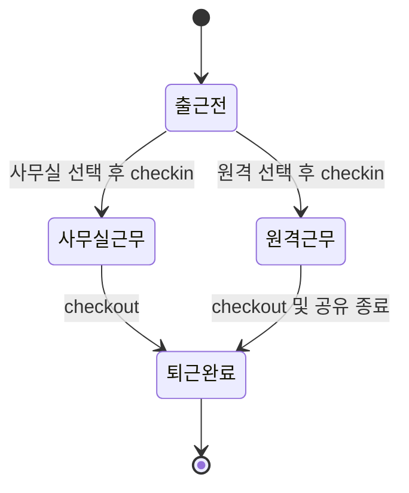

# 업무 처리 메커니즘

근거: [workspace.tsx](../app/workspace.tsx), [route.ts](../app/api/erp/route.ts).

## 1. 인사와 프리랜서

관리자는 구성원 등록·수정 폼을 제출하고 `employee-save`를 호출한다. 신규 ID는 서버 UUID이며 role은 member, 초기 비밀번호 해시와 최초 변경 표시도 생성한다. 인사 수정은 이름·이메일·소속·직무·유형·프로젝트·입사일·월 금액을 갱신한다. 기존 role·비밀번호는 바꾸지 않는다.

직원·프리랜서 유형은 계약 구분이며 권한과 별개다. 프로젝트는 단일 문자열로 보관한다. 프리랜서의 계약 종료일·다중 계약·근무 투입률, 직원 휴직·퇴사·휴가·조직 계층은 현재 모델에 없다. 새 계정은 로그인 화면에서 이메일을 직접 입력해 로그인한다. 비로그인 회원등록은 `/register`를 사용한다. 최초 비밀번호 변경을 완료해야 아래 업무 흐름에 접근한다.

검색과 계약 유형 필터는 브라우저에서 이미 받은 employees 배열에 적용한다. 원격 검색 API나 페이지 단위 조회는 없다.

본인의 이름·소속·직무는 헤더 사용자 이름 → 회원정보변경 모달에서 `profile-save`로 저장한다. 일반 구성원도 사용할 수 있으며 서버는 세션의 본인 행만 갱신한다. 비밀번호변경 메뉴는 현재 비밀번호·새 비밀번호·확인을 입력하는 모달을 열고 `password-change`로 저장한다. 두 변경 모두 완료 후 스냅샷을 다시 조회한다.

## 2. 출퇴근



이 상태도는 한 한국 날짜의 정상 흐름이다. 당일 퇴근 후 재출근·출근 장소 변경은 지원하지 않는다. 다음 날짜에도 미퇴근이 남아 있으면 퇴근 후 새 출근을 해야 한다.

### 출근

서버는 먼저 본인의 `check_out IS NULL` 기록을 날짜와 무관하게 조회한다. 있으면 409다. 없으면 한국 날짜와 서버 ISO 시각을 계산해 `INSERT OR IGNORE`한다. 동일 구성원·날짜의 기존 기록이 있으면 유일 제약으로 삽입되지 않아 409다. 같은 날 동시 출근은 한 건만 저장된다.

출근 장소 선택은 출근 전 가능하며 UI는 오늘 기록 또는 미퇴근 기록이 있으면 선택과 출근 버튼을 비활성화한다. API도 별도로 중복을 검증한다.

### 퇴근

서버는 본인의 모든 미퇴근 기록에 같은 퇴근 시각을 넣고 미종료 remote 행도 종료한다. 이 두 UPDATE는 같은 write batch에 들어간다. 출근 갱신 행이 없으면 이후 409를 반환한다. 따라서 비정상적으로 remote만 남아 있는 경우에도 원격 UPDATE 자체는 먼저 실행될 수 있다.

자정이 넘어도 출근일 day를 바꾸지 않는다. 별도 야간 근무 분할·휴게시간·연장근로 판정·수정 요청·관리자 대리 출퇴근은 없다. 로그아웃과 브라우저 종료는 자동 퇴근이 아니다.

### 조회와 CSV

표의 기록 시간은 `max(0, floor((퇴근 또는 serverTime - 출근)/60초))`의 시·분 표시다. 클라이언트가 매초 렌더링해도 미퇴근 경과 시간 기준은 직전 GET의 serverTime이므로 다음 조회 때 갱신된다.

CSV는 현재 배열의 선택 월만 담고 이름·근무일·장소·출근·퇴근 열을 사용한다. UTF-8 BOM과 CRLF, 큰따옴표 이스케이프를 적용하고 `= + @ -`로 시작하는 셀에는 작은따옴표를 앞에 붙인다. 데이터는 최근 500건으로 제한되고 서버 전체 이력 내보내기가 아니다.

## 3. 원격근무 상태 공유

### 선행 조건과 시작

공유 시작은 출근을 대신하지 않는다. 서버에서 아래 조건을 모두 확인한다.

1. 현재 로그인한 본인의 출근 기록이다.
2. day가 서버 기준 오늘의 한국 날짜다.
3. check_out이 NULL이다.
4. mode가 정확히 `원격`이다.
5. consent가 boolean true이고 업무 내용 task가 1~200자다.

조건이 맞으면 remote 행을 생성하거나 계정 PK 충돌 시 덮어쓴다. 시작 시 started_at·heartbeat·last_active는 현재 서버 시각, ended_at은 NULL, visible은 1이다. 과거 공유 내역은 별도 누적하지 않는다.

### 클라이언트 heartbeat

Snapshot에서 본인 remote 행에 ended_at이 없으면 공유 중으로 판단한다. `lib/use-remote-presence.ts`가 즉시, 이후 20초마다 heartbeat를 보낸다. 공유 시작 버튼 클릭에서 Idle Detection 권한을 요청하며, 허용된 권한은 새로고침 후 자동 재사용한다. 권한 거절·미지원·초기화 오류는 unknown으로 전송하고 업무·연결 공유는 계속한다.

| 입력 | 처리 |
| --- | --- |
| IdleDetector `change` | 기기 활동·유휴 및 화면 잠금 상태를 즉시 전송 |
| `visibilitychange` | 즉시 heartbeat 전송 |
| `online` | 통신 복구 시 heartbeat 전송 |
| 타이머 | 20초마다 heartbeat 전송 |

IdleDetector의 threshold는 공통 설정 idleMinutes × 60000ms다. 관리자는 헤더 사용자 메뉴의 원격지원설정 모달에서 1~120분 정수(기본 5분)를 저장한다. 모든 로그인 사용자가 GET으로 설정을 받고 공유 중 값이 바뀌면 기존 감지기를 정리한 뒤 새 값으로 재시작한다. 기본 갱신 주기는 15초다. 최소화나 탭 숨김은 자리비움 판정에 사용하지 않는다. 활동 감지는 지원 브라우저·보안 컨텍스트(HTTPS 또는 신뢰 가능한 로컬 개발 환경)·사용자 권한이 필요하다. 입력 내용·좌표·프로그램 이름·화면·카메라는 수집하지 않는다. 미지원 환경에서 웹페이지 내부 입력으로 대신 판정하지 않는다.

서버는 heartbeat·visible·user_state·screen_state를 저장한다. last_active는 active+unlocked일 때 서버 시각으로 갱신하지만 상태 판정에는 사용하지 않는다. 기존 active 필드는 무시한다. visible은 참고용이며 자리비움과 무관하다. 권한 변경 시 감지기를 재생성하고 unknown부터 재전송한다. 공유 종료·로그아웃·컴포넌트 해제 시 감지·타이머·리스너를 정리한다.

### 화면 상태 판정 순서

```text
remote 행 없음 또는 ended_at 있음 → 공유 안 함
현재 클라이언트 시각 - heartbeat > 3분 → 연결 확인 필요
screen_state=locked 또는 user_state=idle → 자리 비움
user_state=active 그리고 screen_state=unlocked → 활동 중
그 외 → 자동 판정 불가
```

접속 지연에 대한 유예를 기존 90초에서 3분으로 늘렸다. 정확히 3분은 연결 확인 필요로 바뀌지 않으며 초과 시 바뀐다. 연결 상태는 자리비움보다 우선한다. 상태 문구는 각 브라우저가 계산하고 관리자는 15초 GET과 1초 clock으로 표시한다. 백그라운드 실행·절전·탭 중단으로 실시간 전달을 보장하지 않으며 실제 업무 수행 여부를 의미하지 않는다.

### 종료와 예외

| 동작 | 결과 |
| --- | --- |
| 공유 종료 | ended_at 저장, 근무는 계속 미퇴근 |
| 퇴근 | 출근 기록 마감과 원격 종료 |
| 로그아웃 | 현재 세션 삭제와 계정 원격 종료, 출근은 유지 |
| 앱 종료·네트워크 차단 | 명시 종료 없음. heartbeat 3분 초과 후 연결 확인 필요 |
| 공유 중 새로고침 | 서버의 미종료 공유를 다시 읽어 heartbeat 재개 가능 |
| 브라우저 세션 만료 | 새 heartbeat는 인증 실패, 종료 시각 자동 저장 없음 |

공유 화면의 카드는 ended_at이 없는 행을 보여 주므로 연결 확인 필요 카드도 남는다. 종료한 행은 DB·GET에는 남지만 목록에서는 제외된다.

같은 계정의 여러 기기·탭은 하나의 remote 행을 함께 갱신하므로 마지막 보고가 우선한다. 공유 브라우저는 한 곳을 사용하는 것이 권장된다. 다른 프로그램 사용 중에도 기기 활동을 감지할 수 있지만 어떤 앱에서 무슨 작업을 하는지는 판별하지 않는다.

원격 시작 시에만 오늘 출근 조건을 검사한다. heartbeat는 미종료 remote 행만 검사하고 출근일·근무 장소를 재확인하지 않는다. 자정이 지나도 기존 공유가 자동 종료되지 않는다.

## 4. 급여와 프리랜서 정산

관리자가 대상 월을 선택해 `payroll-generate`를 요청하면 입사·계약 연월이 대상 월 이하인 모든 구성원에 대해 생성한다. 직원·프리랜서 모두 같은 규칙이다.

```text
base = 생성 당시 employees.salary
adjustment = 0
deduction = 0
status = 검토 대기
지급 예정액 = base + adjustment - deduction
```

월별 유일 제약과 `INSERT OR IGNORE`로 기존 건은 유지한다. 생성 후 인사 salary를 수정해도 이미 생성한 정산 base는 바뀌지 않는다. 재생성은 새 대상자를 추가할 수 있지만 기존 금액을 재산출하지 않는다.

관리자는 수당·공제·검토 상태를 수정할 수 있으며 공제가 base+수당을 초과하면 거절한다. 검토 완료 후에도 다시 수정하거나 검토 대기로 되돌릴 수 있다. 수정자·수정 시각 이력·승인 단계·지급 잠금은 없다. 계산에 출퇴근·원격 활동 데이터는 사용하지 않는다.

세금·보험·일할·초과 근무 계산과 실제 송금은 연결되어 있지 않다. 과거월 생성도 현재 salary를 사용하므로 역사적 급여 복원 기능으로 취급하지 않는다.
